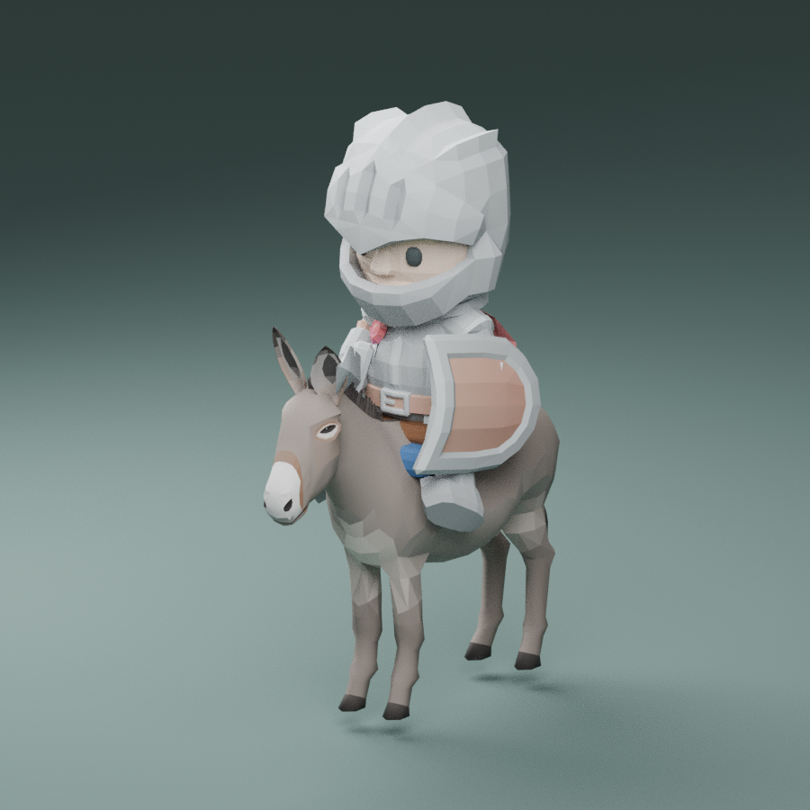

# v2 mounted models and animations

The `v2_dev` branch replaces the primitive segmented player with a free-use Polyfork donkey and KayKit knight. It keeps the existing controller, terrain, enemies, progression, difficulty, HUD and save data. The models are stylized and more detailed; no paid “HD edition” assets are included.



This is an asset preview, not a Unity or Android gameplay capture.

## Animation and mobile budget

- Donkey: idle breathing/ears, walk, run/charge and rear kick. Original saddle and blue saddlecloth follow its spine.
- Knight: seated idle and riding balance, forward charge posture, alternating chop/slash, shield guard, whirlwind and kick balance. Seated lower-body poses persist through the source combat clips. The rider follows the donkey’s spine along with the saddle.
- Gait selection and cadence use actual horizontal movement speed, including analog joystick input; a blocked mount returns to idle.
- Bone rotations interpolate with spherical interpolation. Entering/leaving a state blends over 140–160 ms; one-shot sword clips play over 0.5 seconds.
- 8,698 triangles, 8,728 vertices, 67 bones and two model renderers. Runtime rig data is below 1 MiB; vertex colors replace additional model textures.
- Explicit bind matrices, four-weight skinning, full clip bounds and a serialized material reference address the previous importer/culling/shader risks. These models use Unity's skinned rendering with a custom compact asset loader, without FBX, Humanoid Avatars or asset postprocessor callbacks.

## Sources and reproducibility

Original downloads and licenses are in `Tools/AssetSources/MountedV2`; see `sources.json`. The Polyfork free GLB is used under CC BY 4.0, and KayKit model/animations under CC0. Attribution is also in Camp → Asset Credits.

```sh
blender -b -t 2 --python Tools/build_mounted_v2.py
python Tools/check_mounted_v2.py
blender -b -t 4 --python Tools/preview_mounted_v2.py
```

Blender 4.3.2 and numpy were used. Export verifies four-weight skinning against Blender's evaluated geometry and verifies each local pose can be represented by Unity transforms. The independent binary validator checks source hashes, topology, weights, quaternions and bounds at 384 stored/intermediate poses. Generated checksums and budgets are in `generated.json`.

## Unity / Android verification still required

Unity is unavailable in the authoring environment, so these checks do not replace Unity compilation, Play Mode or a phone benchmark.

1. Fetch and switch to `v2_dev`, then open with Unity **6000.4.11f1**. Wait for imports before entering Play Mode.
2. Run **Forest Rider → Report mounted rendering (Play Mode)**. It checks every clip and half-key pose using Unity `BakeMesh`, restores the current pose, and reports bounds and camera visibility. Only this diagnostic performs CPU mesh baking.
3. Orbit the camera from all sides. Check rider seating, sword/shield placement, saddle, feet on hills and visibility near the screen edges.
4. Walk, stop, charge, dodge, attack repeatedly, guard, whirlwind and kick. Check transition smoothness, pauses, death/revive and reset progress.
5. Build and test an Android development APK at Low, Medium and High. Record CPU/GPU frame times, memory, skinning cost and allocations while riding and using skills. Confirm both models render after background/resume and cold launch.

Do not infer low-end performance or Android rendering success from the Blender preview alone.
