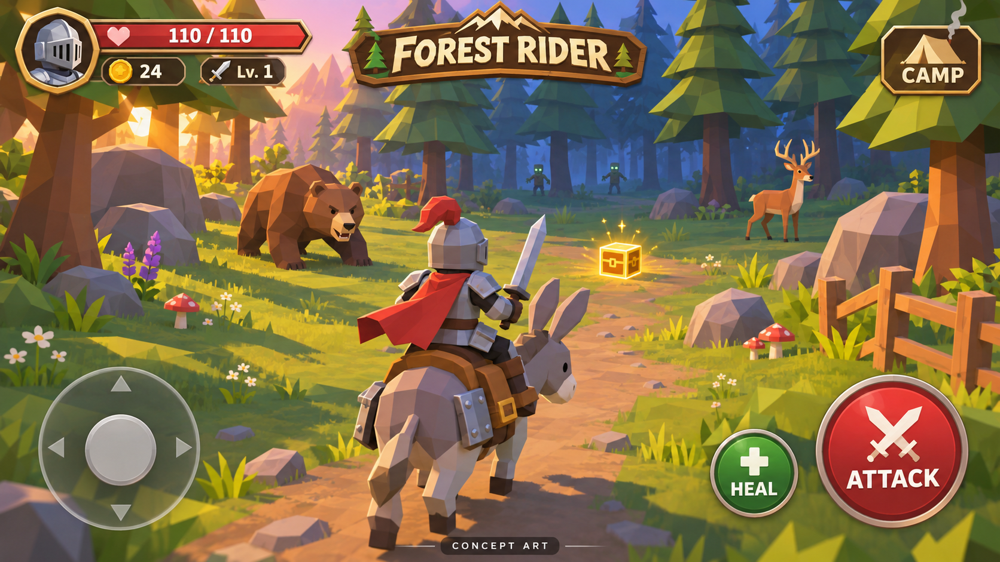

# Forest Rider

A Unity 2022.3 LTS C# mobile PvE prototype. Ride an armored donkey through a seeded 3D forest, fight bears, deer, moose, wolves and foxes, survive zombies at night, and collect ten gems to summon a dragon. Ground uses native Unity Terrain with generated hills, surface textures and grass. Enemies use included free-use model assets by Quaternius and Poly by Google, with licenses and credits in [THIRD_PARTY.md](THIRD_PARTY.md). The rider, donkey and scenery remain original primitive geometry; no paid assets are required.

## Visual concept



This generated concept illustrates the intended art direction; it is not a screenshot of the current prototype.

## Run

1. Install Unity **2022.3.62f1** with Android Build Support (SDK, NDK, OpenJDK) and/or iOS Build Support through Unity Hub.
2. Add this folder as a project and open it. Allow the initial model/animation import and compilation to finish; the included FBX files need no external importer.
3. The editor generates `Assets/Scenes/Forest.unity` and registers it for builds. If needed use **Forest Rider → Create or open game scene**.
4. Press Play. The game creates its world, rider, enemies, camera, lighting, and UI automatically when the scene loads.

Mobile: drag the left stick to ride; ATTACK swings in front of your donkey; DODGE dashes forward with brief damage immunity; HEAL uses a potion; OFFER GEMS deposits carried gems at the central altar; CAMP pauses combat and opens equipment, save, revive and asset credits. Desktop: WASD/arrows to ride, Space to attack, Shift to dodge, H to heal, E to offer gems, Escape for camp, F5 to save. Movement is relative to the fixed follow camera. Ride over golden loot cubes to collect them.

## Rules

- Start with a level 1 sword, rider armor, donkey armor, and three potions.
- Bears, deer, moose, wolves and foxes roam the forest. Deer and foxes flee until struck. Wolves are faster pursuers; moose defend their space and have more health and damage. Models retain supplied animation clips; bear and moose use static source meshes.
- A full day lasts six real minutes. Night spawns zombies, which disappear at dawn.
- Every kill awards coins and has a 65% chance to drop a potion, sword upgrade, rider armor, donkey armor, or extra coins, each equally likely.
- Gear caps at level 10. Camp upgrades cost 40 times the current level. Armor reduces incoming damage, up to 65%; both armor types increase maximum health. Potions restore 50 health.
- Death keeps equipment and progress. CAMP → REVIVE restores health and returns you to the clearing.
- Local JSON saves preserve health, position, day phase, kills, coins, potions, equipment, collected gem IDs, altar deposits and dragon victory. Manual save, 30-second autosave, loot collection, upgrades, death, application backgrounding and quit write progress. Save files live in `Application.persistentDataPath/forest-rider.json`; a backup and temporary file provide recovery copies. Enemy positions and dropped loot are transient. Uninstalling the app can remove saves.

## Ten gems and the dragon

- Find ten unique glowing turquoise gems around the forest. The HUD shows the nearest uncollected gem's distance and cardinal direction (north is forward in the normal camera). Ride over a gem to collect it. Each has a stable saved ID, so reloading never duplicates a pickup.
- Ride within 4.5 metres of the central altar and use **OFFER GEMS / E**. You can deposit gems in batches. All ten light the altar and summon the dragon. Ordinary enemies despawn and stop spawning during the encounter.
- **Aerial fireballs — 10 seconds:** the dragon circles above the altar and fires roughly every 1.4 seconds. Orange circles lock onto your position when each shot launches. After 1.2 seconds, the fireball hits a 2.1m-radius area for 22 base damage. Ride out or dodge; the shot does not keep tracking you.
- **Dive warning — 1.5 seconds:** a red 3m-radius marker locks onto your position. Move out before the dragon commits.
- **Dive — 0.8 seconds:** the dragon dives to the marked location and deals 36 base damage on impact. Each dive deals damage only once.
- **Stunned — exactly 5 seconds:** the dragon is grounded, a green ring appears, and sword hits can damage it. Outside this window it is immune. The cycle repeats until its 650 health is depleted.
- **DODGE / Shift:** 0.32-second forward dash and damage immunity, with a 1.6-second cooldown. Collision and terrain still apply, so dodge toward open space. Armor also reduces dragon damage.
- Leaving the arena (32m from the altar) resets boss health and hazards. Return to restart. Death/revival and reloading restart an unlocked fight at full boss health; your ten deposited gems remain safe. Boss health and attack phase are transient.
- Victory awards 500 coins and three potions and saves the dragon-defeated flag. The boss is a one-time progression encounter in the current save.

## Terrain

The forest now uses Unity's built-in **Terrain**, **TerrainData**, **TerrainCollider**, **TerrainLayer** and billboard grass detail system. A deterministic 257 × 257 heightmap spans 180 × 180 metres with broad hills and a flat camp clearing; the playable area remains approximately 172 × 172 metres. Moss/grass, earth/leaf litter and stone textures are generated locally, with dirt trails, patchy earth and rock blended by path position, slope and elevation. These are original procedural textures, not downloaded photographic assets.

Grass is omitted from trails and steep slopes and renders within 38 metres to limit mobile cost. Terrain uses instanced rendering and a 128 × 128 detail map. Adjust constants and generation parameters in `Assets/Scripts/ForestTerrain.cs` to tune the landscape. The terrain is created at runtime: inspect it during Play Mode; terrain edits made then are not persisted.

Trees and stones sit on the terrain. The rider and creatures use character controllers to follow slopes; spawns, loot, loaded saves and revival sample the actual ground height. The camera checks terrain/trunk obstruction and stays above the ground. Existing saves keep their X/Z positions and equipment and adapt to the new elevation on load.

In Play Mode, use **Forest Rider → Validate terrain (Play Mode)** to check height relief, layer weights, grass, the camp clearing and agreement between height samples and terrain physics. This validation has been added but cannot be executed without Unity.

## Build

**Forest Rider → Build Android APK** generates `Builds/ForestRider.apk`, using IL2CPP, ARM64 and minimum Android API 26. Install the Android module first. Unity may download the target SDK required by your installed tooling. Use Build Settings to configure distribution signing and publish an AAB if desired.

**Forest Rider → Build iOS Xcode project** exports `Builds/iOS`. Finish signing and building on macOS with Xcode and an Apple developer provisioning profile.

Batch example after installing Unity:

```sh
Unity -batchmode -quit -projectPath "$PWD" -executeMethod DonkeyForest.Editor.GameBuild.Android -logFile build.log
```

## Validation and limits

The Unity editor is unavailable here. The three engine-independent NUnit tests for gem progression and dragon timing passed under .NET 8; all C# files passed C# 9 syntax parsing; model meshes, textures and animation clips passed Blender round-trip checks. No APK, device run, or compilation against Unity APIs has been verified here. Run the checklist in `TESTING.md` before using the game on a device. The visuals are intentionally prototype quality: a primitive rider/donkey and props, procedural terrain textures and mixed free model styles. Source animations are retained for deer, wolves, foxes, zombies and the dragon; bear and moose models are static. No music, hand-sculpted terrain or audio is included. The world is bounded to an approximately 172m square; at most 22 enemies are active. No ads, accounts, network play, analytics, or cloud saves.

## Automated checks

`python3 Tools/check_project.py` checks repository structure, asset licensing records and model files. `blender -b --python Tools/verify_models.py` checks the converted FBX meshes, textures and animation clips. In Unity, open **Window → General → Test Runner → EditMode → Run All** for gem uniqueness/deposit tests and exact dragon phase timing/order tests. The same three NUnit test methods passed outside Unity under .NET 8. Running them through Unity Test Runner is still required to validate the project environment.
